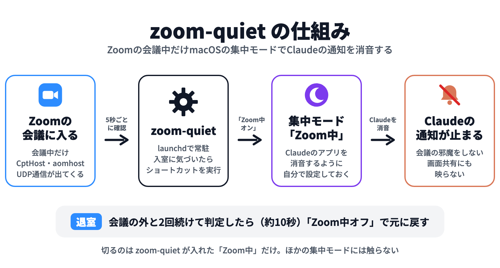

# zoom-quiet

[](https://github.com/chaenmasahiro0425/zoom-quiet/actions/workflows/ci.yml)


[English](README.en.md) | 日本語

**Zoom の会議中だけ、Claude の通知を止める macOS 用の小さなツールです。**

会議に入ると macOS の集中モードを自動で入れ、退室したら切ります。
集中モードで「Claude のアプリを消音」にしておけば、会議中だけ Claude Code（デスクトップアプリ・CLI）の通知が止まります。
画面共有中に通知が映ったり、話の途中で音が鳴ったりしなくなります。


▶ **解説動画（54秒）**: [docs/media/zoom-quiet-explainer.mp4](docs/media/zoom-quiet-explainer.mp4)

- 依存なし（macOS 標準の bash・pgrep・netstat・shortcuts だけ）
- ログイン時に launchd で自動起動し、5秒ごとに判定（CPU 使用率はほぼ 0%）
- 切るのは自分が入れた「Zoom中」だけ。ほかの集中モード（おやすみモードなど）には触らない
- Claude 以外のアプリ（Slack・ターミナルなど）を一緒に止めるかどうかは、集中モード側で自由に選べる

## 仕組み



```
launchd ─▶ zoom-quiet run（5秒ごと）
              │
              ├─ 会議中か？  CptHost / aomhost が動いている、または zoom.us が UDP で通信している
              │
              ├─ 入室したら  shortcuts run "Zoom中オン"  → 集中モード「Zoom中」がオン
              └─ 退室したら  shortcuts run "Zoom中オフ"  → 集中モード「Zoom中」がオフ
```

会議に入ると Zoom は `CptHost` と `aomhost` という補助プロセスを起動し、本体が UDP で音声・映像を流し始めます。
会議の外ではどれも出ません（macOS 26.6 / Zoom で実測）。この3つのどれかがあれば会議中とみなします。

macOS には集中モードを直接切り替えるコマンドがないので、ショートカット App 経由で切り替えます。

## インストール

```bash
git clone https://github.com/chaenmasahiro0425/zoom-quiet.git ~/zoom-quiet
```

1. **集中モード「Zoom中」と、ショートカット2つを作る**（初回のみ・約3分）→ [docs/setup.md](docs/setup.md)
2. 自動起動を有効にする

```bash
~/zoom-quiet/bin/zoom-quiet install
```

最後に `doctor` の結果が全部 ✓ になれば準備完了です。

## 使い方

ふだんは何もしなくて大丈夫です。Zoom の会議に入ると数秒で集中モードが入り、退室すると切れます。

```bash
zoom-quiet status      # いま会議中か・集中モードを入れているか
zoom-quiet check       # 会議中なら終了コード 0（スクリプトやhookから使う）
zoom-quiet on / off    # 集中モードを手で入れる／切る（動作確認用）
zoom-quiet doctor      # 設定の点検
zoom-quiet uninstall   # 自動起動をやめる
```

`zoom-quiet` を短く打ちたい場合は PATH に通してください。

```bash
ln -s ~/zoom-quiet/bin/zoom-quiet /opt/homebrew/bin/zoom-quiet
```

ログは `~/.local/state/zoom-quiet/zoom-quiet.log` に出ます。

## Claude Code の hook と組み合わせる

CLI の Claude Code で完了音などを hook で鳴らしている場合は、会議中だけ鳴らさないようにできます（`~/.claude/settings.json`）。

```json
{
  "hooks": {
    "Stop": [
      { "hooks": [ { "type": "command",
        "command": "~/zoom-quiet/bin/zoom-quiet check -q || afplay /System/Library/Sounds/Glass.aiff",
        "async": true } ] }
    ]
  }
}
```

ターミナルから出る通知（iTerm2・Ghostty などのバナー）は、集中モードの消音対象にそのターミナルのアプリを足せば止まります。

## 設定

`~/.config/zoom-quiet/config`（`install` のときに [config.example](config.example) から作られます）

| 項目 | 既定値 | 意味 |
|---|---|---|
| `INTERVAL` | `5` | 何秒ごとに判定するか |
| `LEAVE_CHECKS` | `2` | 会議の外と何回続けて判定したら切るか |
| `ON_SHORTCUT` / `OFF_SHORTCUT` | `Zoom中オン` / `Zoom中オフ` | 実行するショートカットの名前 |
| `ON_CMD` / `OFF_CMD` | なし | ショートカットの代わりに実行するコマンド（両方書いたときだけ有効） |
| `ACTION_TIMEOUT` | `20` | オン／オフの操作を打ち切る秒数 |
| `UDP_MIN` | `1` | Zoom本体のUDP通信がこの本数以上なら会議中（`0` で無効） |

変更後は `launchctl kickstart -k gui/$(id -u)/com.github.zoom-quiet` で反映されます。

## 注意

- 判定の間隔の分（最大5秒ほど）、入室直後の通知が出ることがあります
- 集中モードの「デバイス間で共有」がオンだと、iPhone なども一緒に集中モードになります。Mac だけにしたい場合はオフにしてください
- `CptHost` は Zoom の画面共有にも使われるため、会議の外で画面共有の機能だけを使ったときも集中モードが入る可能性があります（未確認）
- 判定方法は Zoom の内部プロセス名に頼っているため、Zoom の更新で変わる可能性があります。動かなくなったら `zoom-quiet status` で確かめてください
- macOS の集中モードの状態は外から読めないため、「Zoom中」を会議前に手で入れていた場合も、退室時に切れます
- 設定ファイルはシェルとして読み込みます。自分だけが書ける場所（既定の `~/.config/zoom-quiet/`）に置いてください

## アンインストール

```bash
~/zoom-quiet/bin/zoom-quiet uninstall
```

集中モードとショートカットは手で削除してください。

## 動作確認した環境

- macOS 26.6（Apple Silicon）
- Zoom Workplace（2026年10月時点の版）

ほかの環境で動いた・動かなかったという報告は Issue で歓迎します。

## ライセンス

[MIT](LICENSE)

Zoom は Zoom Video Communications, Inc.、Claude は Anthropic の商標です。このツールはどちらの企業とも関係のない非公式のツールです。
